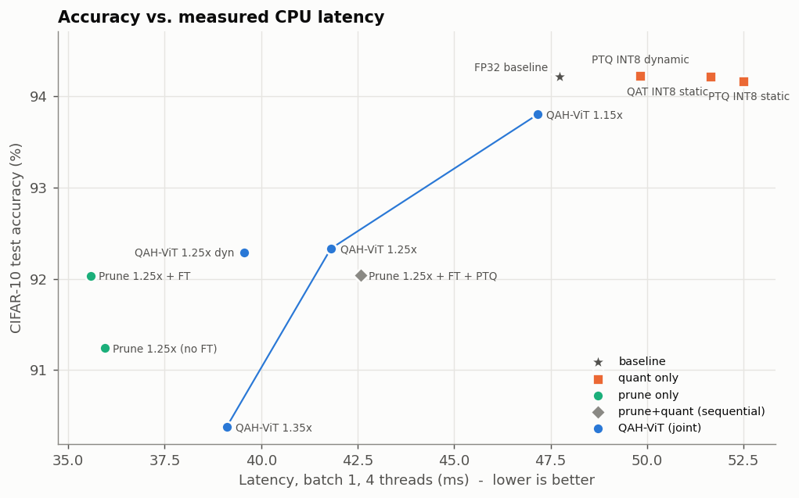
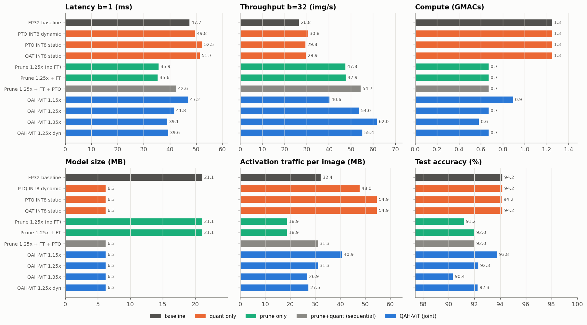
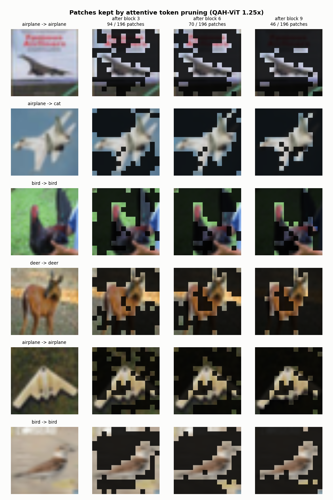

# QAH-ViT: Quantization-Aware, Hardware-Aware Token Pruning for Vision Transformers

A PyTorch pipeline that compresses a Vision Transformer with **token pruning** and **INT8 quantization**. The pruning schedule is chosen with a **latency model measured on the target hardware**, and the network is fine-tuned with pruning and quantization active together. It is evaluated on accuracy, compute (GMACs), memory and real CPU latency.

Everything was run on a laptop: Intel i5-10210U (4 cores), 7.5 GB RAM, no usable GPU. PyTorch 2.4 runs on the CPU, with fbgemm handling the INT8 kernels.

## 1. Setup

| | |
|---|---|
| Model | **DeiT-Tiny** (5.5 M params, 1.25 GMACs, 12 blocks, 197 tokens), ImageNet-pretrained. It is small enough to fine-tune on a CPU but is a real ViT with enough tokens to prune. |
| Task | CIFAR-10 upsampled to 224×224. Splits: 48k train / 2k val (used for search) / 10k test (final numbers only). |
| Baseline | Full fine-tuning: 1500 steps × batch 16 (about half an epoch, 64 min on the CPU). Reaches **94.21% test**. |
| Latency | Median of 100 runs, batch 1, 4 threads (also reported: 1 thread, and batch-32 throughput). |

The ViT is implemented from scratch (`qahvit/model.py`) with key names compatible with timm, so the official DeiT weights load directly. No extra dependencies are needed.

## 2. Approach

```
DeiT-Tiny ──► FP32 fine-tune ──► (A) token-pruning study ──► (B) latency LUT on this CPU
                                                                   │
                       (C) LUT-guided schedule search under latency budgets
                                                                   │
              (D) joint fine-tuning: pruning + INT8 QAT ──► (E) INT8 deployment + benchmark
```

**A. Token pruning (EViT-style attentive pruning).** At blocks 3, 6 and 9, patch tokens are ranked by the attention the [CLS] token gives them. The top `r·N` are kept and the rest are merged into one attention-weighted "fused" token. Every later layer then runs on fewer tokens.

**B. Hardware profiling.** I measured the latency of the attention half and the MLP half of a block for **every sequence length N = 2…197**. Each was measured in FP32, INT8-dynamic and INT8-static, along with the cost of the pruning operator. This produces a look-up table (LUT). End-to-end latency is predicted as the sum of LUT entries plus a calibrated constant overhead.

**C. Hardware-aware search.** The search space is the keep ratio at each pruning block, `r ∈ {0.4,…,1.0}³`, × token rounding {none, multiple of 8}, which gives 686 schedules. Latency is *predicted* for all of them at no cost using the INT8 LUT. For each budget (1.15×, 1.25×, 1.35× faster than FP32), only the "maximal" schedules are scored on validation data (raising any ratio further would break the budget). The best one is kept.

**D. Quantization-aware fine-tuning.** Every Linear layer in the transformer blocks becomes a `QLinear` with fake-quantized weights (INT8, symmetric, per-channel) and activations (per-tensor, EMA ranges). The output requantization of the static INT8 kernels is also simulated, so training sees exactly what deployment computes. Gradients pass through the rounding via the straight-through estimator. The selected pruning schedule is **active during QAT** (300 steps), so the weights adapt to both compressions at once.

**E. Deployment.** QLinear modules are swapped for real `torch.ao.nn.quantized` INT8 kernels, using either the static ranges learned in QAT (W8A8) or dynamic activation quantization. The patch embedding and classifier stay in FP32.

## 3. Results (CIFAR-10 test set, 10k images)

| Variant | Acc (%) | GMACs | Size (MB) | Latency b=1 (ms) | Latency b=1, 1 thread | Throughput b=32 (img/s) | Act. traffic / img (MB) |
|---|---|---|---|---|---|---|---|
| FP32 baseline | **94.21** | 1.253 | 21.1 | 47.7 | 84.5 | 26.8 | 32.4 |
| PTQ INT8 dynamic | 94.22 | 1.253 | 6.3 | 49.8 | 75.0 | 30.8 | 48.0 |
| PTQ INT8 static | 94.16 | 1.253 | 6.3 | 52.5 | 77.6 | 29.8 | 54.9 |
| QAT INT8 static | 94.21 | 1.253 | 6.3 | 51.7 | 77.2 | 29.9 | 54.9 |
| Prune 1.25× (no fine-tune) | 91.24 | 0.677 | 21.1 | 35.9 | 52.1 | 47.8 | 18.9 |
| Prune 1.25× + FT (FP32) | 92.03 | 0.677 | 21.1 | 35.6 | 52.2 | 47.9 | 18.9 |
| Prune 1.25× + FT → PTQ (sequential) | 92.04 | 0.677 | 6.3 | 42.6 | 50.0 | 54.7 | 31.3 |
| **QAH-ViT 1.15×** | **93.80** | 0.898 | 6.3 | 47.2 | 61.3 | 40.6 | 40.9 |
| **QAH-ViT 1.25×** | **92.33** | 0.677 | 6.3 | 41.8 | 49.5 | 54.0 | 31.3 |
| **QAH-ViT 1.35×** | **90.38** | 0.588 | 6.3 | 39.1 | 45.1 | 62.0 | 26.9 |
| QAH-ViT 1.25× (dynamic INT8 deploy) | 92.29 | 0.677 | 6.3 | 39.6 | 47.7 | 55.4 | 27.5 |

Schedules found by the search (keep ratio at blocks 3/6/9, token count rounded to a multiple of 8): 1.15× → `0.7/1.0/0.5`, 1.25× → `0.5/0.7/0.7`, 1.35× → `0.4/0.6/0.5`. Raw numbers are in `results/final.json`.

**Headline (QAH-ViT 1.25×):** −1.9 pts accuracy for **−46% compute, 3.35× smaller model, 2.0× throughput, 1.7× lower single-core latency**. The mildest setting (1.15×) loses only 0.4 pts while giving 1.5× throughput and a 3.35× smaller model.

<p align="center"></p>
<p align="center"></p>

## 4. Key findings

1. **Which tokens are kept matters** (Fig. 1). At 35% fewer MACs, CLS-attention scoring keeps 94.5% val accuracy, against 93.5% for L2-norm scoring and 92.8% for random. At aggressive ratios the gap reaches 10 pts. Fusing pruned tokens gives only a small gain here.
2. **Searched schedules beat uniform ones at equal latency** (Fig. 4). Before any fine-tuning, the gains over the best uniform schedule within the same budget are +0.9, +2.1 and +4.9 pts (95.7 vs 94.8, 93.4 vs 91.3, 90.6 vs 85.7). The search prefers pruning hard early and gently late, or skipping a stage, and it always picked hardware-friendly token counts (multiples of 8).
3. **Joint pruning + QAT beats doing them one after the other.** At an identical cost (same schedule, same INT8 kernels, same latency), QAH-ViT reaches 92.33% against 92.04% for prune → fine-tune → PTQ. It also needs one fine-tune instead of separate prune and quantize steps.
4. **Quantization alone costs no accuracy.** PTQ and QAT stay within ±0.05 pts of FP32 while shrinking the model 3.35× (21.1 → 6.3 MB).
5. **Hardware reality: INT8 does not speed up batch-1 inference on this CPU** (Fig. 2). For DeiT-Tiny's small 192-wide layers, eager-mode INT8 has a fixed quantize/dequantize cost (about 0.6 ms per block). It also *increases* activation traffic by 70% (32 → 55 MB per image), because every quantize/dequantize writes a new tensor. INT8 only pays off when compute dominates: batch 32 (+15% throughput) or single-thread (−11% latency). **Token pruning is what cuts latency**, because it shrinks every op, including attention, GELU and LayerNorm. A MAC count would miss all of this; the measured LUT captures it.
6. **GMACs ≠ latency.** −46% MACs gives only −25% batch-1 latency, because each block has a latency floor of about 1.1 ms (FP32) / 1.8 ms (INT8) even at 20 tokens. Latency is also not linear in N (Fig. 3).
7. **The LUT latency model is accurate.** Its mean absolute error against measured end-to-end latency is 2.7% across all variants (Fig. 7).
8. **Peak activation memory is unchanged by pruning** (1.7 MB at b=1, 55 MB at b=32 for every variant, measured exactly with the PyTorch profiler). The peak occurs in blocks 0–2, before the first pruning stage. Pruning reduces total activation traffic instead (−42% FP32).

## 5. All figures (`plots/`)

| | |
|---|---|
| `fig1_pruning_methods.png` | accuracy vs GMACs for 4 token-selection methods (training-free) |
| `fig2_latency_lut.png` | measured block latency vs tokens, and INT8 speed-up vs tokens |
| `fig3_lut_staircase.png` | zoom on the LUT: non-linear, spiky latency in N |
| `fig4_hw_search.png` | search space, budgets, selected vs uniform schedules |
| `fig5_accuracy_vs_latency.png` | main trade-off plot |
| `fig6_all_metrics.png` | latency, throughput, GMACs, size, activation traffic, accuracy |
| `fig7_lut_prediction.png` | predicted vs measured latency |
| `fig8_training.png` | fine-tuning loss curves |
| `fig9_token_visualization.png` | which patches survive each pruning stage |

<p align="center"></p>

## 6. Reproduce

```bash
pip install -r requirements.txt
PY=python ./run_all.sh   # ~4.5 h on a 4-core laptop CPU; each stage is skipped if its output exists
```

The DeiT-Tiny weights (`checkpoints/deit_tiny_patch16_224.pth`, from `dl.fbaipublicfiles.com/deit/`) and CIFAR-10 (`data/`) are expected locally.

```
qahvit/   model.py (ViT + token pruning) · quant.py (QAT + INT8 deployment) · hw.py (LUT latency predictor)
          metrics.py (accuracy, MACs, size, latency, memory) · data.py
scripts/  train.py · latency_lut.py · search.py · evaluate.py · plots.py · visualize_tokens.py
results/  latency_lut.json · search.json · final.json         logs/  all training/eval logs
```

## 7. Limitations and honest notes

- **Short fine-tuning budgets** (CPU only): the baseline saw about 0.5 epoch and each compression fine-tune 300 steps (4.8k images). Longer training would raise every number, and especially help the aggressive 1.35× schedule.
- **Realized speed-ups are smaller than the budget targets** (1.01×, 1.14×, 1.22× instead of 1.15×, 1.25×, 1.35× at b=1). The INT8 predictions themselves were accurate, but the FP32 reference ran faster during the final benchmark (47.7 ms) than during profiling (51.5 ms). Laptop CPUs vary with thermal state.
- The search scores candidates training-free on 1k validation images, which is a noisy proxy (±0.7 pts). Validation accuracy (drawn from the training distribution) runs about 1 pt higher than test accuracy.
- Attention matmuls, softmax, GELU and LayerNorm stay in FP32. Fused INT8 kernels (e.g. ONNX Runtime/TensorRT) would remove the quantize/dequantize overhead found in finding 5.
- The activation range is 7-bit (fbgemm `reduce_range`) to avoid int16 overflow on CPUs without VNNI, such as this one.
